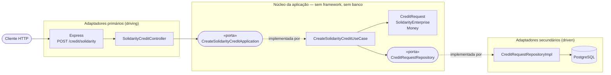

# Arquitetura hexagonal — módulo de crédito solidário

Documento de apoio à atividade *Projeto Integrador: Arquitetura Hexagonal*.
Ele descreve como o módulo `src/solidarity-credit/` está organizado, por que as
portas têm essa granularidade e como a regra de dependência é verificada — não
apenas prometida.

- Backlog e critérios de aceite: [`backlog-atividade-hexagonal.md`](./backlog-atividade-hexagonal.md)
- Endpoint: `POST /credit/solidarity`

---

## 1. Desenho do hexágono

Quem aponta para quem: o adaptador de entrada e o de saída dependem do núcleo
(implementam ou consomem suas portas). O núcleo não conhece nenhum dos dois —
por isso as setas de dentro não saem do hexágono.

---

## 2. Direção das dependências

| Elemento | Arquivo | Depende de | Pode ser trocado sem tocar em… |
|---|---|---|---|
| `SolidarityCreditController` (driving) | `adapters/http/SolidarityCreditController.ts` | `CreateSolidarityCreditApplication` (porta) | núcleo |
| `CreateSolidarityCreditApplication` (porta primária) | `application/ports/` | domínio (tipos) | — |
| `CreateSolidarityCreditUseCase` | `application/useCases/` | porta primária (implementa), porta secundária (consome), domínio | adaptadores |
| `CreditRequest`, `SolidarityEnterprise` | `domain/` | `Money`, erros de domínio | — |
| `CreditRequestRepository` (porta secundária) | `application/ports/` | domínio (tipos) | — |
| `CreditRequestRepositoryImpl` (driven) | `adapters/prisma/` | porta secundária (implementa), Prisma | núcleo |

O composition root é `adapters/http/solidarity-credit.routes.ts`: único lugar que
instancia `CreditRequestRepositoryImpl` e `CreateSolidarityCreditUseCase`. Trocá-los
(por um repositório em memória, por outro banco, por um dublê em teste) é editar
esse arquivo e nada mais.

---

## 3. Por que essa granularidade de portas

**Uma porta de saída com dois métodos**, e não duas portas
(`CreditRequestRepository` + `SolidarityEnterpriseRepository`):

* a necessidade real do caso de uso é **uma unidade de trabalho** — o empreendimento
  e a solicitação têm de ser gravados juntos. Dividir em duas portas sugeriria que o
  caso de uso coordena duas operações independentes, e a atomicidade acabaria
  aparecendo no núcleo, que passaria a falar de transação;
* o método `save(creditRequest, enterprise)` expressa isso em linguagem de domínio:
  o núcleo diz *o que* precisa ser atômico, o adaptador decide *como*;
* granularidade fina continua possível como refinamento: extrair
  `SolidarityEnterpriseRepository` e fazer `save` orquestrar os dois repositórios
  dentro de uma transação **não muda** o caso de uso nem o controller — está anotado
  como item opcional no backlog.

**Uma porta primária com um método**: o contrato do adaptador de entrada é
exatamente o caso de uso. Não há "porta de listagem" porque não há caso de uso de
listagem — criar uma interface com métodos que ninguém chama seria cerimônia vazia.

**O que não entrou na porta**: o tipo `Client`/`TxClient` de `src/prisma/db.ts`.
Importá-lo (mesmo só o tipo) amarraria o núcleo ao Prisma. É o que a checagem
automática da seção 5 existe para impedir.

---

## 4. Rastreamento do que a atividade pediu

| Exigência | Onde está |
|---|---|
| Caso de uso | `application/useCases/CreateSolidarityCreditUseCase.ts` |
| Porta primária | `application/ports/CreateSolidarityCreditApplication.ts` |
| Domínio | `domain/CreditRequest.ts`, `domain/SolidarityEnterprise.ts`, `Money` (reusado) |
| Porta secundária | `application/ports/CreditRequestRepository.ts` |
| Adaptador de entrada | `adapters/http/SolidarityCreditController.ts` |
| Adaptador de saída | `adapters/prisma/CreditRequestRepositoryImpl.ts` |
| Persistência em banco | Prisma 8 / PostgreSQL — tabelas `CreditRequest` e `SolidarityEnterprise` (`migrations/app/20261016T0208_add_solidarity_credit`) |

---

## 5. Como a regra de dependência é verificada

1. **`npm run check:hexagon`** percorre `domain/` e `application/` e falha (exit 1) se
   algum arquivo importar `express`, `@prisma/*`, `src/prisma/`, `src/http/`,
   `node:http` ou `adapters/`. O script foi testado ao contrário: com um import
   proibido injetado de propósito, ele aponta arquivo e linha e retorna 1.
2. **`npm run test:unit`** roda o domínio e o caso de uso com um repositório em
   memória — **sem `DATABASE_URL`**. Se a infraestrutura vazasse para o núcleo, esta
   suíte deixaria de rodar; é o teste mais barato e mais honesto do isolamento.
3. **`npm run typecheck`** cobre também os testes (`tsconfig.test.json`), então a
   anotação `CreateSolidarityCreditApplication` no teste do caso de uso acusa, em
   tempo de compilação, qualquer desvio do contrato da porta.

---

## 6. Decisões registradas

| # | Decisão | Justificativa |
|---|---|---|
| D1 | Nomes de classe exatamente como sugeridos no enunciado | `CreateSolidarityCreditUseCase`, `CreateSolidarityCreditApplication`, `CreditRequest`, `SolidarityEnterprise`, `CreditRequestRepository`, `SolidarityCreditController`, `CreditRequestRepositoryImpl` |
| D2 | O controller depende da **porta** `CreateSolidarityCreditApplication`, não da classe do caso de uso | Sem isso a inversão de dependência existiria só no discurso: o adaptador de entrada estaria soldado à implementação |
| D3 | O caso de uso recebe `CreditRequestRepository` (interface) no construtor | É o que permite o dublê em memória nos testes de unidade e a troca de banco sem tocar no núcleo |
| D4 | `save(creditRequest, enterprise)` como unidade de trabalho | Atomicidade é decisão do adaptador; o núcleo só declara que as duas escritas andam juntas. Ver seção 3 |
| D5 | `amount` é `Money`, montado na fronteira com `Money.fromInput` | `Money` é objeto de valor do domínio e o validador de dinheiro do projeto: evita um segundo tipo de valor na borda |
| D6 | Erros de domínio reusados de `src/models/errors.ts` | Módulo sem framework; duplicá-lo obrigaria o `errorHandler` a conhecer dois vocabulários |
| D7 | Empreendimento localizado pelo `document` e criado se não existir | Um único POST resolve a solicitação inteira, sem exigir cadastro prévio que a atividade não pede. O nome reenviado não sobrescreve o cadastro existente |
| D8 | **Não inventamos** política de limite de crédito, fluxo de aprovação nem regra de "uma pendência por empreendimento" | São decisões de negócio do banco comunitário, não do exercício; entraram como itens opcionais, para serem justificadas se forem pedidas |
| D9 | `status` existe com o valor inicial `"pending"` | O crédito tem ciclo de vida; guardar o estado agora evita uma migration quando a análise existir. Nenhuma transição foi implementada |

---

## 7. Extensibilidade: o que um adaptador novo exigiria

| Cenário | O que muda | O que **não** muda |
|---|---|---|
| Testes de caso de uso sem banco | um segundo arquivo de teste (já existe: `test/unit/`) | caso de uso, domínio, controller |
| Persistência em outro banco | uma classe nova implementando `CreditRequestRepository` + 1 linha no composition root | caso de uso, domínio, controller, porta |
| Endpoint alternativo (CLI, fila, gRPC) | um adaptador primário novo chamando a mesma porta | caso de uso, domínio, adaptador de saída |
| Listar solicitações | novo método na porta primária + caso de uso próprio | `CreateSolidarityCreditUseCase` |
| Aprovar/recusar crédito | novo caso de uso + transição de estado no domínio (e ampliar `CreditRequestStatus`) | o caso de uso de solicitação |

---

## 8. Convivência com o restante do projeto

O módulo de contas (`src/models`, `src/services`, `src/repositories`, `src/controllers`)
continua organizado **em camadas**, conforme a proposta arquitetural da Entrega 1. A
atividade pede arquitetura hexagonal para a funcionalidade de crédito solidário, e a
opção adotada foi entregá-la como **módulo autocontido** em vez de reorganizar o
projeto inteiro:

* o núcleo nasce limpo e a fronteira do que é hexagonal fica explícita na árvore de
  diretórios (e verificável pelo `check:hexagon`);
* o módulo novo serve de referência: migrar contas para o mesmo desenho é um
  trabalho posterior, com a suíte de 21 testes de integração já existente como rede
  de segurança;
* o custo aceito é ter duas topologias convivendo por um tempo — registrado como
  item herdado no backlog.
